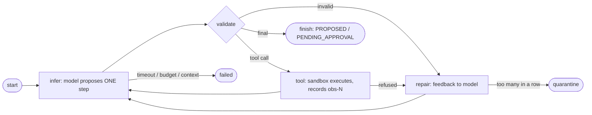

# TAGO — T4 Agent Graph Orchestrator

[](https://colab.research.google.com/github/NLarchive/tago/blob/main/notebooks/tago_v38_t4-agent_graph_orchestration.ipynb)
[](https://github.com/NLarchive/tago/actions/workflows/ci.yml)

TAGO is a **sandboxed evaluation lab for tool-using LLM agents**. One notebook runs a language model through ten fictional enterprise workflows: refund escalation, CRM update, invoice reconciliation, access review, cited knowledge answers, a code fix, procurement, a fictional compliance rule, security triage and booking. A hidden rubric grades every answer for correctness, evidence and human-approval gating.

It runs on a free **Google Colab T4** with a local model (Ollama, `qwen2.5:7b` by default), and can compare other local models or API models under identical rules.

> **Name.** TAGO = **T4 Agent Graph Orchestrator**: an *agent* (a language model deciding one step at a time) run through a bounded *graph* (state machine) by a generic *orchestrator*, sized for a free Colab **T4** GPU.

## What it measures



- The model **never sees the private case facts**. It must call tools such as `ticket_read`, `reconcile` or `graph_walk`, and each successful call becomes an observation `obs-N`.
- A final answer must give typed findings, cite the observations they came from, and quote them **character for character**.
- Actions are **proposed, never executed**. Refunds, purchases, access grants and bookings end as `PENDING_APPROVAL`.
- A hidden **oracle** computes the right answer from the private facts, independent of what the model's tools returned. Each failure gets a category (`tool_argument_schema`, `duplicate_tool_loop`, `citation_grounding`, `wrong_finding`, …).

## Results

### Real (measured)

Six real runs exist (Runs A–F), all on a **Colab T4**, with `qwen2.5:7b` as the baseline (Ollama, temperature 0). Run F also compares other local models. Raw artifacts are committed under [`results/`](results/) and the tables below are generated from them (a test checks that this README matches).

**Run A — v3.7** ([`results/v37_colab_t4_qwen2.5-7b/`](results/v37_colab_t4_qwen2.5-7b/)):

<!-- BEGIN GENERATED: v37-results -->
| Run | Model | Passed | Calls | First call s | Median warm s |
|---|---|---|---|---|---|
| `v37_colab_t4_qwen2.5-7b` | qwen2.5:7b | 0/3 | 13 | 119.13 | 1.11 |

| Run | Case | Result | Failure category | Model calls | Tool calls OK | Duplicate calls | Repairs | Tools used |
|---|---|---|---|---|---|---|---|---|
| `v37_colab_t4_qwen2.5-7b` | E01 | QUARANTINED | tool_argument_schema | 7 | 4 | 3 | 3 | ticket_read, ticket_read, ticket_read, ticket_read |
| `v37_colab_t4_qwen2.5-7b` | E03 | QUARANTINED | tool_argument_schema | 3 | 0 | 0 | 3 | - |
| `v37_colab_t4_qwen2.5-7b` | E06 | QUARANTINED | tool_argument_schema | 3 | 0 | 0 | 3 | - |
<!-- END GENERATED: v37-results -->

The model sent `retrieve {}`, `invoice_read {"invoice_id": …}` (the key should be `reference`) and `code_read {}`, and repeated each refused call byte for byte, because the repair message never said which key was expected.

**Run B — v3.8.1** ([`results/v38_1_colab_t4_qwen2.5-7b/`](results/v38_1_colab_t4_qwen2.5-7b/)):

<!-- BEGIN GENERATED: v381-results -->
| Run | Model | Passed | Calls | First call s | Median warm s |
|---|---|---|---|---|---|
| `v38_1_colab_t4_qwen2.5-7b` | qwen2.5:7b | 0/3 | 18 | 79.56 | 1.37 |

| Run | Case | Result | Failure category | Model calls | Tool calls OK | Duplicate calls | Repairs | Tools used |
|---|---|---|---|---|---|---|---|---|
| `v38_1_colab_t4_qwen2.5-7b` | E01 | QUARANTINED | output_schema | 5 | 2 | 0 | 3 | ticket_read, retrieve |
| `v38_1_colab_t4_qwen2.5-7b` | E03 | QUARANTINED | output_schema | 6 | 3 | 0 | 3 | invoice_read, receipt_read, reconcile |
| `v38_1_colab_t4_qwen2.5-7b` | E06 | QUARANTINED | output_schema | 7 | 3 | 0 | 4 | code_read, code_check, code_check |

Synthetic sweep of the same run:

| Workflow | Mode | Attempted | Reached the orchestrator | Passed | Outcomes | Failure categories |
|---|---|---|---|---|---|---|
| E01 | clean | 1 | 0 | 0 | {"generation_error": 1} | - |
| E01 | noisy | 1 | 0 | 0 | {"generation_error": 1} | - |
| E03 | clean | 1 | 1 | 0 | {"orchestrator_failure": 1} | {"wrong_reference": 1} |
| E03 | noisy | 1 | 1 | 0 | {"orchestrator_failure": 1} | {"wrong_reference": 1} |
| E06 | clean | 1 | 0 | 0 | {"generation_error": 1} | - |
| E06 | noisy | 1 | 1 | 0 | {"orchestrator_failure": 1} | {"wrong_reference": 1} |
<!-- END GENERATED: v381-results -->

Still 0/3, but progress is hidden by the headline number. Every tool call now had the right tool and keys, and E03's arithmetic was correct (`overcharge 5000`, `payable 25000`). What failed was the **step envelope**: `kind:"tool"` with `tool:null` plus findings, a `final` with no `status`/`action`, repeated reads, and one paraphrased citation. In the synthetic sweep the model also copied the schema's description text into the `reference` value (6×), and half of the generated cases were invalid. Warm-up took 68 s yet the first timed call took 79.6 s (context-size reload). Full analysis: [`docs/v38_review.md`](docs/v38_review.md).

**Run C — v3.8.2** ([`results/v38_2_colab_t4_qwen2.5-7b/`](results/v38_2_colab_t4_qwen2.5-7b/)): state-conditioned schema on.

<!-- BEGIN GENERATED: v382-results -->
| Run | Model | Passed | Calls | First call s | Median warm s |
|---|---|---|---|---|---|
| `v38_2_colab_t4_qwen2.5-7b` | qwen2.5:7b | 0/3 | 17 | 93.8 | 5.16 |

| Run | Case | Result | Failure category | Model calls | Tool calls OK | Duplicate calls | Repairs | Tools used |
|---|---|---|---|---|---|---|---|---|
| `v38_2_colab_t4_qwen2.5-7b` | E01 | QUARANTINED | citation_grounding | 5 | 2 | 0 | 3 | ticket_read, retrieve |
| `v38_2_colab_t4_qwen2.5-7b` | E03 | QUARANTINED | citation_grounding | 6 | 3 | 0 | 3 | invoice_read, receipt_read, reconcile |
| `v38_2_colab_t4_qwen2.5-7b` | E06 | QUARANTINED | citation_grounding | 6 | 3 | 0 | 3 | code_read, code_check, code_check |

Synthetic sweep of the same run:

| Workflow | Mode | Attempted | Reached the orchestrator | Passed | Outcomes | Failure categories |
|---|---|---|---|---|---|---|
| E01 | clean | 1 | 1 | 0 | {"orchestrator_failure": 1} | {"wrong_reference": 1} |
| E01 | noisy | 1 | 1 | 0 | {"orchestrator_failure": 1} | {"wrong_status": 1} |
| E03 | clean | 1 | 1 | 0 | {"orchestrator_failure": 1} | {"citation_grounding": 1} |
| E03 | noisy | 1 | 1 | 0 | {"orchestrator_failure": 1} | {"citation_grounding": 1} |
| E06 | clean | 1 | 1 | 0 | {"orchestrator_failure": 1} | {"tool_refused": 1} |
| E06 | noisy | 1 | 1 | 0 | {"orchestrator_failure": 1} | {"citation_grounding": 1} |
<!-- END GENERATED: v382-results -->

Still 0/3, and again a different failure. No `output_schema`, `tool_argument_schema` or duplicate-call failure remains: every call used the right tool and arguments, and every reported value was correct (`overcharge_cents 5000`, `payable_cents 25000`, `refund_cents 9000`). All nine final answers were refused for the same reason: the model **re-formatted the JSON it quoted** (`"refund_cents": 9000` instead of `"refund_cents":9000`) or paraphrased it, and repeated the mistake after feedback. All six synthetic cases reached the orchestrator (three of six in Run B), but none passed: two were invalid cases that the same-model auditor accepted, and one valid case failed on the final `status`.

**Reading the three runs together.** Each version removed one class of failure and exposed the next one:

| Run | Dominant failure | What the model got right |
|---|---|---|
| A · v3.7 | `tool_argument_schema` | Choosing tools |
| B · v3.8.1 | `output_schema` (step envelope) | Tool arguments |
| C · v3.8.2 | `citation_grounding` | Envelope, tools, values |

**Run D — v3.8.3** ([`results/v38_3_colab_t4_qwen2.5-7b/`](results/v38_3_colab_t4_qwen2.5-7b/)): grounded quotes on. **The first run with passing cases.**

<!-- BEGIN GENERATED: v383-results -->
| Run | Model | Passed | Calls | First call s | Median warm s |
|---|---|---|---|---|---|
| `v38_3_colab_t4_qwen2.5-7b` | qwen2.5:7b | 2/3 | 13 | 1.82 | 1.44 |

| Run | Case | Result | Failure category | Model calls | Tool calls OK | Duplicate calls | Repairs | Tools used |
|---|---|---|---|---|---|---|---|---|
| `v38_3_colab_t4_qwen2.5-7b` | E01 | PASS | - | 3 | 2 | 0 | 0 | ticket_read, retrieve |
| `v38_3_colab_t4_qwen2.5-7b` | E03 | PASS | - | 4 | 3 | 0 | 0 | invoice_read, receipt_read, reconcile |
| `v38_3_colab_t4_qwen2.5-7b` | E06 | QUARANTINED | citation_grounding | 6 | 3 | 0 | 3 | code_read, code_check, code_check |

Synthetic sweep of the same run:

| Workflow | Mode | Attempted | Reached the orchestrator | Passed | Outcomes | Failure categories |
|---|---|---|---|---|---|---|
| E01 | clean | 1 | 1 | 1 | {"pass": 1} | - |
| E01 | noisy | 1 | 1 | 1 | {"pass": 1} | - |
| E03 | clean | 1 | 1 | 1 | {"pass": 1} | - |
| E03 | noisy | 1 | 1 | 0 | {"orchestrator_failure": 1} | {"wrong_reference": 1} |
| E06 | clean | 1 | 1 | 1 | {"pass": 1} | - |
| E06 | noisy | 1 | 1 | 0 | {"orchestrator_failure": 1} | {"duplicate_tool_loop": 1} |
<!-- END GENERATED: v383-results -->

E01 and E03 pass with the right tools, values, citations and human-approval gate. The first timed call took 1.8 s (the slow first request now happens inside the warm-up). What still failed:

- **E06 golden:** the final named `obs-1` in a finding but cited only `obs-3`; the validator refused it three times and the model repeated it byte for byte.
- **Synthetic E03 noisy:** the request said "invoice_id 12345" and the model used `invoice_id_12345` as the reference, three times.
- **Synthetic E06 noisy:** after one failed check the model re-sent the same wrong expression until the duplicate guard stopped it. This is a limit of the 7B model's arithmetic, not a schema problem.
- **A grading weakness this run exposed:** E01 passes while citing `"mode":"hybrid"` as evidence for `requires_approval`. The rubric checks that a quote is verbatim and from an observation, not that it supports the finding (backlog V39-02).

**Reading the four runs together:**

| Run | Golden | Dominant failure | What the model got right |
|---|---|---|---|
| A · v3.7 | 0/3 | `tool_argument_schema` | Choosing tools |
| B · v3.8.1 | 0/3 | `output_schema` (step envelope) | Tool arguments |
| C · v3.8.2 | 0/3 | `citation_grounding` (re-formatted quotes) | Envelope, tools, values |
| D · v3.8.3 | **2/3** | `citation_grounding` (one citation missing) | Quotes, values, human gate |

**Run E — v3.8.4** ([`results/v38_4_colab_t4_qwen2.5-7b/`](results/v38_4_colab_t4_qwen2.5-7b/)): one citation per observation, reference candidates. **The first run where every golden case passes.**

<!-- BEGIN GENERATED: v384-results -->
| Run | Model | Passed | Calls | First call s | Median warm s |
|---|---|---|---|---|---|
| `v38_4_colab_t4_qwen2.5-7b` | qwen2.5:7b | 3/3 | 11 | 1.4 | 1.24 |

| Run | Case | Result | Failure category | Model calls | Tool calls OK | Duplicate calls | Repairs | Tools used |
|---|---|---|---|---|---|---|---|---|
| `v38_4_colab_t4_qwen2.5-7b` | E01 | PASS | - | 3 | 2 | 0 | 0 | ticket_read, retrieve |
| `v38_4_colab_t4_qwen2.5-7b` | E03 | PASS | - | 4 | 3 | 0 | 0 | invoice_read, receipt_read, reconcile |
| `v38_4_colab_t4_qwen2.5-7b` | E06 | PASS | - | 4 | 3 | 0 | 0 | code_read, code_check, code_check |

Synthetic sweep of the same run:

| Workflow | Mode | Attempted | Reached the orchestrator | Passed | Outcomes | Failure categories |
|---|---|---|---|---|---|---|
| E01 | clean | 1 | 1 | 1 | {"pass": 1} | - |
| E01 | noisy | 1 | 1 | 1 | {"pass": 1} | - |
| E03 | clean | 1 | 1 | 1 | {"pass": 1} | - |
| E03 | noisy | 1 | 1 | 1 | {"pass": 1} | - |
| E06 | clean | 1 | 1 | 1 | {"pass": 1} | - |
| E06 | noisy | 1 | 1 | 0 | {"orchestrator_failure": 1} | {"step_budget": 1} |
<!-- END GENERATED: v384-results -->

Every golden case passed with no repair, the first timed call took 1.4 s, and the Run D failures are gone: the E06 final cites all three observations and the E03 noisy case used the reference `12345`. What still failed:

- **Synthetic E06 noisy:** after one failed check the model re-sent a wrong expression (`n * (n - 1) // 2 + 100 - 100`); four duplicate calls were refused and the graph stopped at its step budget. This is a limit of the 7B model's arithmetic, not a schema fault, and it is reported as `step_budget` here (Run D: `duplicate_tool_loop`).
- **The grading weakness is unchanged:** E01 still passes while citing `"mode":"hybrid"` for `requires_approval` (backlog V39-02).

**Reading the five runs together (Run F repeats Run E and adds the campaign below):**

| Run | Golden | Dominant failure | What the model got right |
|---|---|---|---|
| A · v3.7 | 0/3 | `tool_argument_schema` | Choosing tools |
| B · v3.8.1 | 0/3 | `output_schema` (step envelope) | Tool arguments |
| C · v3.8.2 | 0/3 | `citation_grounding` (re-formatted quotes) | Envelope, tools, values |
| D · v3.8.3 | 2/3 | `citation_grounding` (one citation missing) | Quotes, values, human gate |
| E · v3.8.4 | **3/3** | none on golden; synthetic E06 arithmetic | Everything the decoder constrains |

Three golden cases cannot separate models (95% interval for 3/3: 44–100%); the scale campaign is what turns this into a measurement.

### What v3.8.4 changed (measured in Run E)


| Fix | Evidence | Pinned by test |
|---|---|---|
| **One citation per observation**: the final schema has a fixed-length citation list, so every `source_id` a finding names is cited | Run D E06 golden | `test_the_rejected_e06_final_is_undecodable_under_the_one_citation_per_observation_schema` |
| **Reference candidates**: a tool `reference` can only be an identifier written in the request | Run D synthetic E03 (`invoice_id_12345`) | `test_the_wrong_reference_could_not_be_decoded_with_request_identifiers` |
| Tool argument text rewritten so it is not a sentence to copy; the citation error names the uncited observation | Run D synthetic E01: the `retrieve` argument description appeared in a query | `test_the_tool_description_that_leaked_into_a_query_is_gone` |

The v3.8.3 fixes (grounded quotes, preflight, synthetic validation, chat warm-up) were confirmed by Run D, and the v3.8.4 fixes by Run E: every row of the table above is gone from the artifacts.

### Run F: the experiment campaign (one notebook run)

[`results/v38_4_campaign_colab_t4/`](results/v38_4_campaign_colab_t4/): ablation ladder, other local models, thinking models and a different-family auditor, each over the three golden cases. The main run in the same session repeated Run E (golden 3/3, synthetic 5/6).

<!-- BEGIN GENERATED: v384-campaign -->
| Item | Kind | Model | Think | Result | Failure categories | First call s | Minutes |
|---|---|---|---|---|---|---|---|
| rung0-v37-behaviour | ablation | qwen2.5:7b | - | 0/3 | {"duplicate_tool_loop": 3} | 2.31 | 0.5 |
| rung1-constrained-guided | ablation | qwen2.5:7b | - | 0/3 | {"duplicate_tool_loop": 2, "output_schema": 1} | 2.51 | 0.4 |
| rung2-state-conditioned | ablation | qwen2.5:7b | - | 2/3 | {"citation_grounding": 1} | 1.46 | 1.0 |
| rung3-grounded-quotes | ablation | qwen2.5:7b | - | 3/3 | {} | 1.36 | 0.7 |
| auditor-granite4.1_8b | auditor | generator/orchestrator qwen2.5:7b, auditor granite4.1:8b | - | 4/6 | {"tool_refused": 1, "step_budget": 1} | - | 4.5 |
| qwen2.5_3b | model | qwen2.5:3b | default | 2/3 | {"duplicate_tool_loop": 1} | 0.71 | 0.3 |
| qwen2.5_14b | model | qwen2.5:14b | default | 2/3 | {"duplicate_tool_loop": 1} | 2.86 | 1.2 |
| llama3.1_8b | model | llama3.1:8b | default | 1/3 | {"missing_provenance": 1, "duplicate_tool_loop": 1} | 2.21 | 0.7 |
| granite4.1_8b | model | granite4.1:8b | default | 2/3 | {"missing_provenance": 1} | 2.46 | 0.9 |
| ministral-3_14b | model | ministral-3:14b | default | 3/3 | {} | 3.86 | 1.4 |
| qwen3.5_9b-think-default | thinking | qwen3.5:9b | default | 3/3 | {} | 8.44 | 2.4 |
| qwen3.5_9b-think-off | thinking | qwen3.5:9b | off | 3/3 | {} | 1.95 | 0.8 |
| gemma4_12b-think-default | thinking | gemma4:12b | default | 3/3 | {} | 5.56 | 3.2 |
| gemma4_12b-think-off | thinking | gemma4:12b | off | 3/3 | {} | 2.77 | 0.9 |
<!-- END GENERATED: v384-campaign -->

What the campaign showed:

- **The ablation ladder reproduces the five-run history on one model.** The same code with the switches turned on one at a time gives 0/3, 0/3, 2/3 and 3/3. Each switch removes the failure class it was built for, so the improvement is not a lucky seed or a different build.
- **E06 (the arithmetic fix) is the case that separates models, and size alone does not decide it.** `qwen2.5:3b`, `qwen2.5:14b` and `llama3.1:8b` loop on `code_check`; `ministral-3:14b`, `qwen3.5:9b` and `gemma4:12b` pass it.
- **Thinking models keep the grammar constraint.** No `output_schema` failure in any run, with `think` on or off. Thinking costs time (first call 5.6–8.4 s against 2–2.8 s, total 2–3× longer) and bought no accuracy on these cases.
- **`granite4.1:8b` and `llama3.1:8b` fail E01 on `missing_provenance`**: they cite a fragment that does not support `requires_approval`.
- **The different-family auditor study is inconclusive.** 4/6 against 5/6, and the generated cases differ between runs, so a one-case difference is noise. It needs the scale campaign.
- **The main run repeats Run E exactly:** golden 3/3 and synthetic 5/6 with the same single failure (E06 noisy, `step_budget`).

### Predictions scored

| Prediction | Run F | Verdict |
|---|---|---|
| Ablation `GROUNDED_QUOTES=False` reproduces Run C | Rung 2: 2/3, the failure is `citation_grounding` (E01) | **Partly confirmed**: same failure class, fewer cases fail because v3.8.4 fixed others |
| Ablation `STATE_CONDITIONED=False` reproduces Run B | Rung 1: 0/3 with `output_schema` and `duplicate_tool_loop` | **Confirmed** |
| All switches off reproduces v3.7 | Rung 0: 0/3, `duplicate_tool_loop` in all three | **Partly confirmed**: 0/3 as in Run A, but the label is `duplicate_tool_loop`, not `tool_argument_schema` |
| qwen2.5:3b is no better than 7B | 2/3 against 3/3 | **Confirmed** (one case; not significant) |
| qwen2.5:14b is about 2× slower and at least as accurate | First call 2.9 s against 1.4 s; 2/3 against 3/3 | **Falsified on accuracy**: the 14B fails E06 |
| Non-thinking granite/ministral: no envelope failures, differences in citations and arithmetic | granite 2/3 (`missing_provenance`), ministral-3:14b 3/3, no `output_schema` failure | **Confirmed** |
| Thinking models are slower, and may weaken `format` | 3/3 in both modes; first call 4–6× slower with thinking on; no `output_schema` failure | **Partly confirmed**: slower yes, `format` held, no accuracy gain over the 3/3 ceiling |
| Different-family auditor changes the accepted set | 4/6 against 5/6; the generated cases differ, so it is one case of noise | **Not decided** at this sample size |

Three golden cases per item cannot rank models: a one-case difference is not evidence. The scale campaign is what turns these into rates.

### Still open (hypotheses, not yet measured)

The two v3.8.4 predictions made before Run E were confirmed, and Run F scored the ablation, model and thinking predictions above. What is still open needs more cases or more settings:

| Setting | Prediction | Would be falsified by |
|---|---|---|
| Scale campaign (20 clean and 20 noisy per workflow) | The 7B pass rate on E06 noisy is well below E01 and E03, and the 14B is not above the 7B | E06 noisy passes as often as the others |
| Different-family auditor at scale | Rejects more generated cases than the same-model auditor | The accepted sets are the same |
| API models (optional) | Near the ceiling on golden | Repeated grounding failures |

Three golden cases cannot rank models: the 95% interval for 2/3 is 21–94%. The scale campaign in [`results/node.tasks.json`](results/node.tasks.json) is what turns these into measurements.

> **How much of a pass is the model, and how much is the decoder?** Each switch moves work from the model to the grammar. A pass with all switches on shows the model can *select* correct values and evidence under a strict contract. It does not show the model can plan unaided. That is why every switch can be turned off and the ablation ladder reports each level.

## Concepts

| Term | Meaning |
|---|---|
| Workflow pack | The workflow-specific part: tools, rubric, prompts and the required status and action. Ten packs (E01–E10). |
| Observation (`obs-N`) | The recorded result of one successful tool call. The only evidence a final answer may cite. |
| Final step | The last model step: typed findings, citations of observations, a `status` and an `action`. |
| Grounded citation | A quote that is a literal substring of the observation it cites. |
| Repair | The graph step that returns the exact validation error to the model. Too many in a row end in quarantine. |
| Hidden oracle | Computes the right findings from private case facts, independent of the model's tools. |
| Constrained / state-conditioned / grounded decoding | Three independent switches that shrink what the decoder can produce: the argument keys, then the legal step for the current state, then the exact quotes. |
| Golden case | A hand-written case per workflow with a known answer. |
| Synthetic case | A case drafted by a model, checked by deterministic rules and an auditor model. Clean and noisy variants. |

## Failure categories

| Category | Meaning |
|---|---|
| `tool_argument_schema` | A tool was called with missing or wrongly named arguments |
| `output_schema` | The step JSON did not match the step contract |
| `duplicate_tool_loop` | The same successful call was repeated |
| `unauthorized_tool` / `tool_refused` | The tool is not allowed in this workflow, or the sandbox refused the call |
| `tool_order` / `premature_final` | A required tool was skipped or called out of order |
| `citation_grounding` | A quote is not in the cited observation, or a finding has no citation |
| `finding_keys` / `wrong_finding` | A finding key is not required, or its value differs from the oracle |
| `wrong_status` / `wrong_action` / `human_gate` | The proposed outcome or the approval gate is wrong |
| `wrong_reference` | The model used a case reference that is not the case's |
| `patch_not_verified` / `patch_overfit` | E06 only: the code check never passed, or the patch only fits the visible examples |
| `budget_exhausted` / `step_budget` / `context_overflow` / `transport_timeout` / `transport_error` | Resource and infrastructure limits |

## Quick start

**Colab (T4).** Open [`notebooks/tago_v38_t4-agent_graph_orchestration.ipynb`](notebooks/tago_v38_t4-agent_graph_orchestration.ipynb) in Colab, choose *Runtime → Change runtime type → T4 GPU*, then *Run all*. Every section explains what it does and what output to expect. Download the ZIP links at the end and commit them under `results/`.

**One run, all the data.** After the main experiment, section 11.6 of the notebook repeats the golden cases under other settings in the same session: the four-rung ablation ladder, a sweep audited by a different model family, other local models, and thinking models (each with `think` default and off). It is on by default in Colab and takes roughly two to three hours on a T4. Models are downloaded and deleted one at a time, a failing item is recorded and skipped, and `TAGO_CAMPAIGN_MAX_MINUTES` bounds the total. Change what it runs with environment variables set before the settings cell, for example `TAGO_CAMPAIGN_MODELS=qwen2.5:3b,llama3.1:8b`, `TAGO_CAMPAIGN_THINKING=`, `TAGO_CAMPAIGN_AUDITOR=` (empty skips) or `TAGO_RUN_CAMPAIGN=0` for the main run only.

**Local (no GPU needed for the checks).**

```bash
pip install -e ".[dev]"
python -m tago test                   # offline contract tests, about 1 s
python -m pytest -q                   # everything, including notebook execution and HTTP end-to-end
python -m tago analyze results/*/     # compare saved runs
```

**Local live run with Ollama.**

```bash
pip install -e ".[live]"
ollama pull qwen2.5:7b
TAGO_RUN_LIVE=1 python -m tago golden qwen2.5:7b qwen2.5:14b
```

**API models (optional).** The project targets models that run on a Colab T4; API backends are provided as a feature to try and are not part of the measured results. Set `OPENAI_API_KEY` (and optionally `OPENAI_BASE_URL` for OpenRouter, vLLM, LM Studio …) or `ANTHROPIC_API_KEY`, then use specs such as `openai:<model-id>` or `anthropic:<model-id>`. In Colab, add the keys under *Secrets* and set `TAGO_MODEL_MATRIX`. API models are sized with a provable byte upper bound because their tokenizers are not public. Their structured output is validated locally, because providers do not all grammar-constrain decoding the way Ollama does.

## Repository layout

The code follows hexagonal rings. Inner rings never import outer rings, and `tests/test_architecture.py` enforces this.

```
tago/
  config.py                  run switches (env-overridable)
  core/domain.py             ring 0: step contract, typed worlds, E06 arithmetic rule
  core/ports.py              ring 1: ChatBackend / ToolHost ports, composition registries
  infrastructure/profiles.py ring 2: model profiles, token preflight
  infrastructure/backends.py ring 2: Ollama, OpenAI-compatible, Anthropic, scripted double
  infrastructure/tools.py    ring 2: retrieval, graph, registry, handlers, sandbox host
  application/packs.py       ring 2: ten workflow packs, prompts, constrained step schema
  application/orchestrator.py ring 2: bounded agent graph
  application/evaluation.py  ring 2: oracle, rubric, failure taxonomy, statistics
  application/synthetic.py   ring 2: case generator and auditor agents
  workflows/                 ring 4: experiments, analysis, offline contract suite
  gateway/project_tasks.py   ring 3: node.tasks.json validator and verifier
  __main__.py                ring 3: CLI (python -m tago …)
notebooks/narrative.md       notebook text; the .ipynb is generated from it plus the package
tools/build_notebook.py      generator (--check fails CI if the notebook is stale)
results/                     committed raw run artifacts (the only source of "real" numbers)
docs/v38_review.md           evaluation of v3.7 and the v3.8 plan
node.tasks.json              project task graph (sub-graphs in tago/, notebooks/, results/)
```

## Project status and definition of done

Work is tracked as a task graph in [`node.tasks.json`](node.tasks.json), with sub-graphs in `tago/`, `notebooks/` and `results/`. Every task carries a verification command, so "done" is checkable:

```bash
python -m tago tasks status     # every task in every graph
python -m tago tasks validate   # structure, dependencies, links, status consistency
python -m tago tasks verify     # re-run the checks of every Done task that can run locally
python -m tago tasks gate       # end condition: all tasks Done and every graph_end check passes
```

## Limitations

- These are fictional sandbox workflows. A pass shows the model followed a grounded, gated procedure, not that it is ready for production.
- Golden cases are tiny (one per workflow). Statistical claims need the planned campaign of ≥ 20 cases per workflow and mode.
- By default the generator, auditor and worker share one model, so their errors are correlated.
- Known grading gaps scheduled for v3.9: the E09 alert reveals the asset before `graph_walk`, and a citation quote only has to be verbatim, not relevant to the finding (Run D: `"mode":"hybrid"` supported `requires_approval`).

## History

v3.1–v3.3: indexed framework and client-agent labs · v3.4–v3.6: agent graph lab · **v3.7**: ten enterprise packs, tokenizer preflight, offline suite, first Colab T4 run (0/3) · **v3.8**: constrained tool schema, loop guard, warm-up, API backends, failure taxonomy, package, CI, generated notebook · **v3.8.1–v3.8.4**: state-conditioned schema, grounded quotes and references, deterministic synthetic validation. See [`CHANGELOG.md`](CHANGELOG.md).

## License

MIT (see `LICENSE`).

## About NLarchive

Built by **Nicolás Larenas** at [NLarchive SpA](https://www.nlarchive.com/) (Santiago, Chile).
We design custom web software, integrations, and grounded AI pilots for businesses:
[AI & Automation Services](https://www.nlarchive.com/servicios/inteligencia-artificial/) · [Projects](https://www.nlarchive.com/proyectos/).

<!-- TAGO-DECISIONS-CONFIRMED -->
